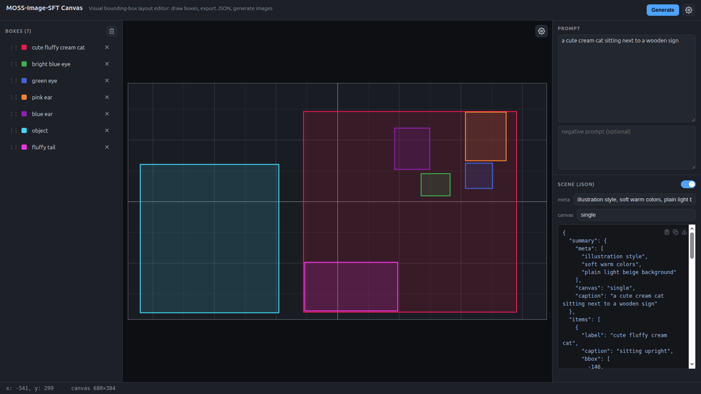
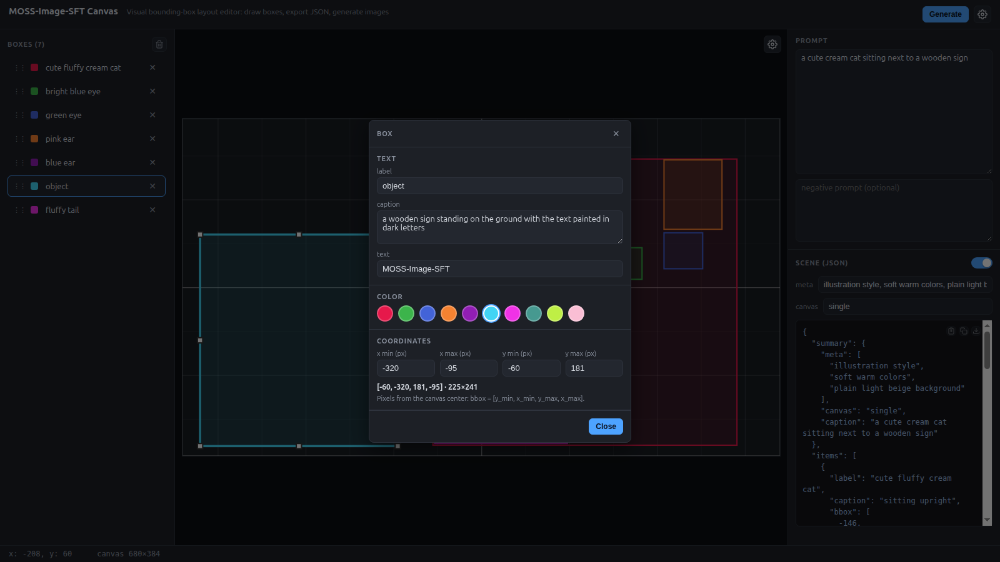
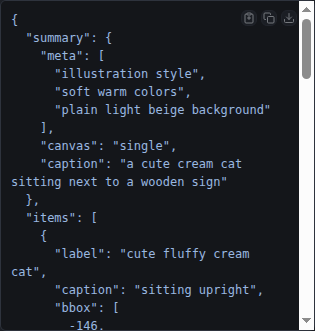
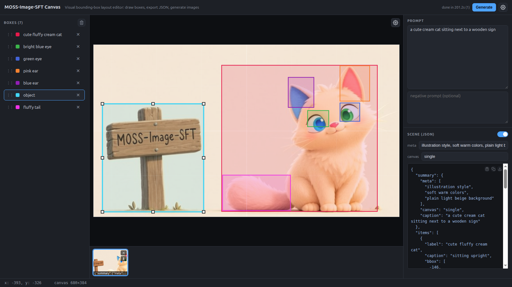
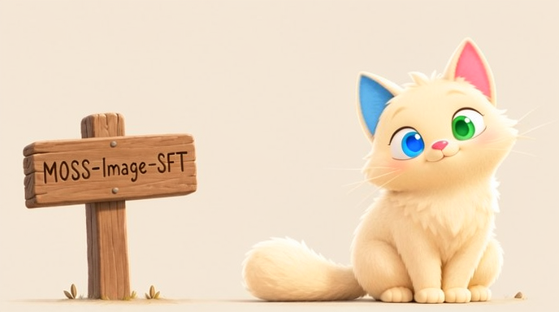
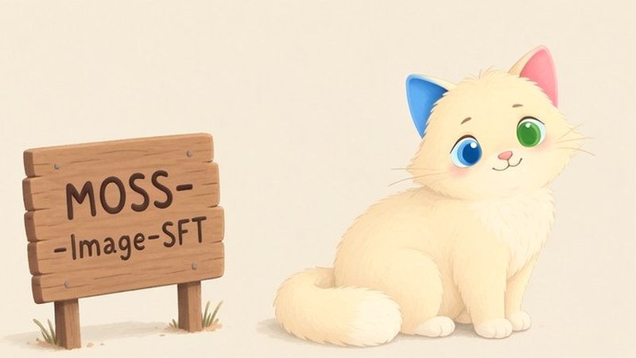

# MOSS-Image-SFT Canvas

A visual bounding-box layout editor for [MOSS-Image](https://github.com/OpenMOSS/MOSS-Image) **Layout-to-image generation**.
Draw and adjust bounding boxes on a canvas, describe the scene and each element, and get the exact JSON layout that
[MOSS-Image-SFT](https://huggingface.co/OpenMOSS-Team/MOSS-Image-SFT) expects as a prompt — no hand-written coordinates.

Optionally, generate the image right inside the app through a
[stable-diffusion.cpp](https://github.com/leejet/stable-diffusion.cpp) (`sdcpp`) server: the app sends the layout JSON
as the prompt, tracks the job, and collects the results in a gallery.



## Quick start

Prerequisites: [Node.js](https://nodejs.org/) ≥ 20.

```bash
git clone https://github.com/g1ts/moss-image-sft-canvas.git
cd moss-image-sft-canvas
npm install
npm run dev
```

Open the printed URL (default <http://localhost:5173>).

Production build:

```bash
npm run build
npm run preview
```

The app is also hosted on [GitHub Pages](https://g1ts.github.io/moss-image-sft-canvas/) — see the note about
generation hosting below.

## How to use

1. **Canvas** — set the size with the gear button on the canvas corner. All coordinates are in pixels from the
   canvas center: on a `W×H` canvas each axis runs from `-W/2 … +W/2` (x → right, y → down).
2. **Boxes** — drag with the mouse over the canvas to draw a box. Double-click a box (or click an item in the left
   list) to edit its label, caption, text, color and exact coordinates. Delete with the `Delete` key or the ✕ button;
   drag list items to change the z-order.
3. **Scene** — fill in `meta` (e.g. `poster`), `canvas` (e.g. `single`) and the `caption` describing the whole scene
   and its style.
4. **JSON** — the layout JSON updates live in the right panel. Copy it, download it, or paste an existing layout back
   into the app to edit it visually.

## Layout JSON format

The app exports/imports the layout format described in the
[MOSS-Image docs](https://github.com/OpenMOSS/MOSS-Image#layout-generation):

```json
{
  "summary": {
    "meta": ["poster"],
    "canvas": "single",
    "caption": "A minimalist travel poster with a cream background, a blue mountain illustration, and the title EXPLORE at the top."
  },
  "items": [
    {
      "label": "text",
      "caption": "Large dark-blue uppercase title centered at the top.",
      "text": "EXPLORE",
      "bbox": [-416, -384, -288, 384]
    },
    {
      "label": "object",
      "caption": "A flat blue mountain illustration in the lower center.",
      "bbox": [-192, -288, 384, 288]
    }
  ],
  "bbox_coord_space": "abs_centralized",
  "bbox_format": "yxyx"
}
```

- `summary.caption` — the overall scene and style; `items` — individual elements.
- Each item has a `label`, a `caption`, an optional `text` (rendered words), and a `bbox`.
- `bbox_format: "yxyx"` — boxes are `[y_min, x_min, y_max, x_max]`.
- `bbox_coord_space: "abs_centralized"` — pixel coordinates relative to the canvas center; on a 1024×1024 canvas each
  axis runs from −512 to +512.

Keep the coordinates consistent with the requested output dimensions: generate the image at the same width/height as
the canvas used to draw the layout.

## Generating images with stable-diffusion.cpp

The app talks to a [`stable-diffusion.cpp`](https://github.com/leejet/stable-diffusion.cpp) server over its HTTP API
(`POST /sdcpp/v1/img_gen`, job polling, `/sdapi/v1/*` for samplers/schedulers/LoRAs). The layout JSON is sent as the
prompt, so the same JSON works in the [MOSS-Image Gradio demo](https://huggingface.co/spaces/OpenMOSS-Team/MOSS-Image)
or any other MOSS-Image frontend.

### 1. Install the server

Download a pre-built binary from the
[releases page](https://github.com/leejet/stable-diffusion.cpp/releases) or
[build from source](https://github.com/leejet/stable-diffusion.cpp/blob/master/docs/build.md).

### 2. Download the MOSS-Image-SFT weights

| File | Where |
| --- | --- |
| MOSS-Image-SFT diffusion model (safetensors) | [Comfy-Org/MOSS-Image · diffusion_models](https://huggingface.co/Comfy-Org/MOSS-Image/tree/main/diffusion_models) · [GGUF](https://huggingface.co/leejet/MOSS-Image-SFT-GGUF) |
| VAE (`flux2_ae.safetensors`) | [Comfy-Org/MOSS-Image · vae](https://huggingface.co/Comfy-Org/MOSS-Image/tree/main/vae) |
| Qwen3.5-9B text encoder (GGUF, e.g. `Q4_K_M`) | [unsloth/Qwen3.5-9B-GGUF](https://huggingface.co/unsloth/Qwen3.5-9B-GGUF) |
| `tokenizer.json` | [OpenMOSS-Team/MOSS-Image-Base · tokenizer](https://huggingface.co/OpenMOSS-Team/MOSS-Image-Base/tree/main/tokenizer) |
| Original model card | [OpenMOSS-Team/MOSS-Image-SFT](https://huggingface.co/OpenMOSS-Team/MOSS-Image-SFT) |

A matching model directory:

```text
models/
  diffusion_models/moss_image_sft_*.safetensors
  text_encoders/Qwen3.5-9B-Q4_K_M.gguf
  vae/flux2_ae.safetensors
  tokenizers/tokenizer_qwen3.5.json
```

### 3. Start the server

```bash
./sd-server --model-dir ./models \
  --diffusion-model models/diffusion_models/moss_image_sft_int8_convrot_attn.safetensors \
  --llm models/text_encoders/Qwen3.5-9B-Q4_K_M.gguf \
  --vae models/vae/flux2_ae.safetensors \
  --tokenizer models/tokenizers/tokenizer_qwen3.5.json \
  --cfg-scale 3.0 --offload-to-cpu
```

Details and model-specific notes: [docs/moss_image.md](https://github.com/leejet/stable-diffusion.cpp/blob/master/docs/moss_image.md).
By default the server listens on <http://127.0.0.1:1234/>; use `--listen-ip <ip> --listen-port <port>` to change the
host/port (use the LAN IP when the app runs in another browser on the same network).

### 4. Use it from the app

1. Open **Settings** (gear button, top right) and enter the server URL, e.g. `http://192.168.31.119:1234` — the
   scheduler/sampler/LoRA lists load automatically.
2. Recommended settings for MOSS-Image: **50 steps**, size **from canvas** (or explicit W/H equal to the canvas).
   CFG 3.0 is the model default; raise it to ~5 for stricter box adherence. LoRAs can be added in *Settings → Advanced*.
3. Press **Generate** (or `Ctrl+Enter`). While the job runs, a **Cancel** button appears.
4. Results land in the gallery below the canvas; "use as background" drops the last image under the boxes so you can
   fine-tune the layout against the generated picture.

> **Hosting note.** Browsers block mixed content, so the image generation from the HTTPS GitHub Pages build cannot
> reach a plain-HTTP server. For generation, run the app locally (`npm run dev`) or serve the production build from
> the server itself: `sd-server --serve-html-path dist/index.html`. The hosted build fully supports drawing layouts
> and exporting/importing JSON.

## Example: a cat with different-colored eyes and ears

A **16:9, ~0.25 MP canvas** (680×384) with seven boxes: the cat itself, its two eyes, its two differently-colored
ears, its tail, and a wooden sign with text. The description is distributed instead of being stuffed into one prompt:
style tags live in `meta`, the scene gist in `caption`, and each element's own words in its `label`/`caption`/`text` —
plain language, like a prompt for a classic text-to-image model.


Double-click a box to edit its `label`, `caption`, `text`, color and exact coordinates. Here the labels carry the
description ("bright blue eye", "pink ear", …), and the sign uses `label: "object"` with the exact words in the
`text` field — the model renders them inside that box.



The app compiles the layout JSON live — this is exactly what gets sent to the model as the prompt:



```json
{
  "summary": {
    "meta": ["illustration style", "soft warm colors", "plain light beige background"],
    "canvas": "single",
    "caption": "a cute cream cat sitting next to a wooden sign"
  },
  "items": [
    { "label": "cute fluffy cream cat", "caption": "sitting upright", "bbox": [-146, -55, 180, 291] },
    { "label": "bright blue eye", "bbox": [-45, 136, -9, 183] },
    { "label": "green eye", "bbox": [-62, 208, -21, 252] },
    { "label": "pink ear", "bbox": [-145, 208, -66, 274] },
    { "label": "blue ear", "bbox": [-119, 93, -52, 150] },
    { "label": "object", "caption": "a wooden sign standing on the ground with the text painted in dark letters", "text": "MOSS-Image-SFT", "bbox": [-60, -320, 181, -95] },
    { "label": "fluffy tail", "caption": "lying on the ground to the left of the cat", "bbox": [99, -53, 178, 98] }
  ],
  "bbox_coord_space": "abs_centralized",
  "bbox_format": "yxyx"
}
```

With the `sdcpp` server connected (CFG 5.0, 50 steps, size from the canvas — the server generates 688×384, the
nearest dimensions divisible by 16), the generated image follows the boxes: the cat sits in its box on the right,
each eye and ear lands in its own box with the right color, the tail lies on the ground to the left of the cat, and
the sign carries the exact text from the `text` field:







## Tech stack

React 19 · TypeScript · Vite · zustand. No backend — the app is a static SPA; all generation is delegated to the
`sdcpp` server.

## License

[MIT](LICENSE)
